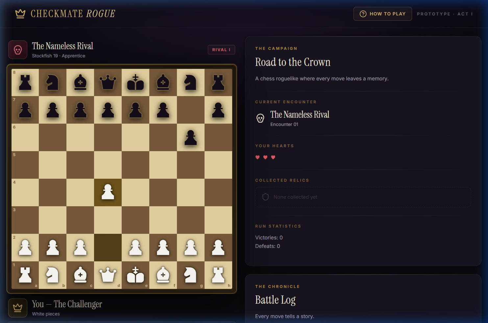
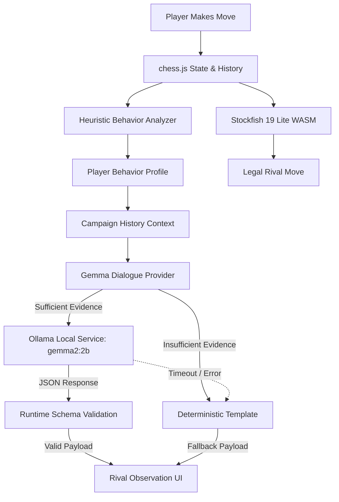
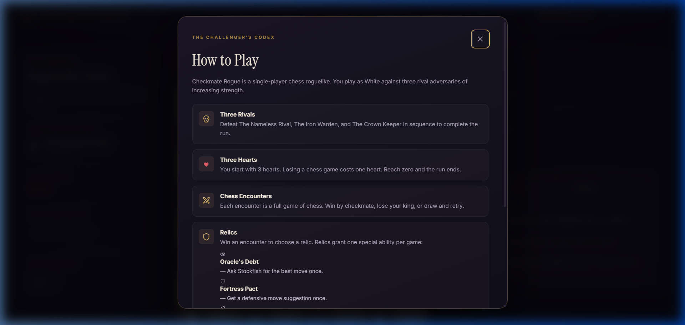

# ♟️ Checkmate Rogue

> **Every move leaves a memory. Every rival learns.**

A gothic chess roguelike where your opponents don't just challenge your moves — they observe your habits, remember your patterns, and confront you with personalized dialogue powered by Google's Gemma.

[](LICENSE)
[](https://react.dev/)
[](https://www.typescriptlang.org/)
[](https://vite.dev/)
[](https://github.com/jhlywa/chess.js)
[](https://stockfishchess.org/)
[](https://ai.google.dev/gemma)
[](https://ollama.com/)
[](https://vitest.dev/)

---



> **Important Architectural Note:** *"Remember"* refers to deterministic application-maintained campaign behavior statistics recorded across moves and completed encounters — not persistent model weight updates or online fine-tuning. Gemma acts as an atmospheric, zero-shot narrative intelligence reasoning over real-time behavioral telemetry.

---

## 🏆 Built for Best Use of Gemma

Checkmate Rogue is an open-source gothic chess roguelike built for the **Best Use of Gemma** category in the Hacktoberfest 2026 Open-Source AI Challenge.

> 📊 **Empirical Quality Report**: We built an automated benchmark suite (`npm run eval:gemma`) evaluating 16 legal chess scenarios against local `gemma2:2b`.
> Read the complete findings in **[docs/GEMMA_EVALUATION.md](docs/GEMMA_EVALUATION.md)** (**100% schema valid**, **93.8% grounded**, **93.8% hallucination-free**, **1,334ms mean latency**).

| Evaluation Metric | Checkmate Rogue Implementation |
|---|---|
| **Model Used** | `gemma2:2b` (Google's open-weight language model) via local [Ollama](https://ollama.com/) |
| **Inference Mode** | 100% private local inference (`http://127.0.0.1:11434/api/generate`) with zero cloud dependencies or paid API keys |
| **Grounding Strategy** | Pure heuristic feature extraction: chess move histories are distilled into deterministic behavioral signals before prompting |
| **Structured Output** | Strict JSON schema enforcement (`{ observation, taunt, tip }`) validated by runtime length and content guards |
| **Gameplay Separation** | Generative AI is strictly decoupled from move calculation: Stockfish 19 Lite WASM decides moves; Gemma provides psychological atmosphere |
| **Graceful Fallback** | Honest, seamless fallback to offline deterministic script templates if Ollama is uninstalled, sleeping, or times out (>10,000ms) |
| **Interactive Inspector** | In-app **Gemma Lab** modal with 6-step guided walkthrough and scenario comparison mode |

---

## 💡 The Idea: Beyond Calculating Moves

Traditional chess engines calculate moves with cold, mathematical precision. They evaluate pawn structures, count material, and calculate mate in 12, but they offer **zero narrative texture**. Playing against Stockfish feels like playing against a calculator.

**Checkmate Rogue bridges competitive chess and gothic storytelling:**

1. **Authentic Chess Mechanics**: Complete, FIDE-compliant chess powered by [chess.js](https://github.com/jhlywa/chess.js) and [Stockfish 19 Lite](https://stockfishchess.org/).
2. **Roguelike Progression**: A 3-heart campaign through three escalating adversaries with permanent death on run failure.
3. **Strategic Relic Trade-offs**: Artifacts that grant single-use tactical interventions in exchange for future campaign penalties.
4. **Behavioral Telemetry**: A deterministic heuristic engine that observes how *you* personally play (queen lunges, delayed castling, pawn storms, reckless checks).
5. **Generative Adversary Psychology**: Google's **Gemma 2** translates your observable habits into atmospheric dialogue, bespoke psychological taunts, and contextual coaching.

Defeating a chess engine is satisfying; facing an adversary that observes you pushing your queen on move 3 and mocks your impatience creates an unforgettable experience.

---

## 🎮 Gameplay Features

### Three Escalating Rivals

A complete run requires defeating three distinct adversaries in sequence:

```
[ Encounter 01 ] ──▶ The Nameless Rival  (Apprentice · Stockfish Skill 0, ELO ~1320, Depth 5)
[ Encounter 02 ] ──▶ The Iron Warden      (Knight     · Stockfish Skill 7, ELO ~1800, Depth 9)
[ Encounter 03 ] ──▶ The Crown Keeper     (Boss       · Stockfish Skill 16, ELO ~2400, Depth 13)
```

### The Three-Heart Campaign

- You begin each run with **3 hearts**.
- **Loss**: Forfeits 1 heart. Reach 0 hearts and the campaign is lost.
- **Draw**: Stalemate, three-fold repetition, or 50-move rule allows you to retry the encounter without heart loss, but grants no relic.
- **Victory**: Advance to the next rival and choose one relic reward.

### Relic Arsenal & Strategic Trade-offs

Relics grant a **single-use tactical ability** per encounter with meaningful strategic penalties:

| Relic | Ability | Strategic Penalty |
|---|---|---|
| 👁️ **Oracle's Debt** | Asks Stockfish for the best move in your current position | Escalates the difficulty of the **next** encounter by +1 tier |
| 🛡️ **Fortress Pact** | Generates an instant heuristic defensive suggestion protecting threatened pieces | Increases rival aggression frequency |
| ⟲ **Knight's Echo** | Reverts your last move and the rival's reply immediately | Forfeits your next relic selection reward upon victory |

---

## 🧠 Why Gemma? — The Intelligence Behind the Rival's Voice

While Stockfish solves the board and chess.js enforces legality, neither can explain *who you are as a chess player*. 

```
                                ┌───────────────────────────┐
                                │   Player Makes Chess Move │
                                └─────────────┬─────────────┘
                                              │
                      ┌───────────────────────┴───────────────────────┐
                      ▼                                               ▼
         ┌─────────────────────────┐                     ┌─────────────────────────┐
         │  Stockfish 19 Lite WASM │                     │  Heuristic Analyzer     │
         │  (Move Calculation)     │                     │  (Habit Telemetry)      │
         └────────────┬────────────┘                     └────────────┬────────────┘
                      │                                               │
                      ▼                                               ▼
         ┌─────────────────────────┐                     ┌─────────────────────────┐
         │  Legal Chess Response   │                     │  Google Gemma 2 (2B)    │
         │  (Board State Updated)  │                     │  (Rival Personality)    │
         └─────────────────────────┘                     └────────────┬────────────┘
                                                                      │
                                                                      ▼
                                                         ┌─────────────────────────┐
                                                         │  Contextual Observation │
                                                         │  & Psychological Taunt  │
                                                         └─────────────────────────┘
```

### Why Generative AI Belongs in Chess

- **Atmospheric Immersion**: Rather than static canned quotes, Gemma produces gothic, prose-rich dialogue tailored to the specific position and rival identity.
- **Cognitive Mirroring**: Gemma notices your recurring blunders and psychological patterns, acting as a living opponent observing you across the board.
- **Constructive Rivalry**: In addition to taunting, Gemma offers subtle tactical tips grounded directly in your detected habits.

### Why Open-Weight Local Inference Matters

1. **Zero Data Leakage**: Your chess games, move tendencies, and habits never touch external servers or third-party cloud APIs.
2. **Zero Operating Cost**: No API tokens, subscription keys, or rate limits. Anyone with a modern laptop can run Gemma locally via Ollama.
3. **Decoupled Reliability**: If Ollama is offline, the game never crashes — it seamlessly uses deterministic scripted templates honestly labeled as `"Scripted dialogue"`.
4. **Model Freedom**: Players and researchers can swap between `gemma2:2b` (ultrafast, ~1.6 GB) and `gemma2:9b` (deep prose) by editing a single environment variable.

---

## ⚙️ How Gemma Powers Adaptive Rival Dialogue

The complete execution pipeline from physical piece drop to dynamic rival dialogue:



### Pipeline Breakdown

1. **Move Execution**: The player completes a move on the board (e.g., `e2 → e4`).
2. **Move Validation**: `chess.js` updates board FEN, captures, checks, and verbose history.
3. **Heuristic Extraction**: `playerBehavior.ts` evaluates the move history against deterministic habit rules.
4. **Context Assembly**: `campaign.ts` supplies aggregate run stats (times castled, checks delivered, early queen habits).
5. **Sufficiency Gate**: If fewer than 3 moves have been played or no habits are detected, the system uses scripted templates directly to avoid unnecessary inference calls.
6. **Prompt Synthesis**: `dialogueProvider.ts` constructs a structured JSON payload containing only non-sensitive behavior summaries.
7. **Local Model Invocation**: An HTTP POST request is sent to Ollama (`/api/generate`) with `model: "gemma2:2b"`, `format: "json"`, and `temperature: 0.7`.
8. **Timeout Guard**: An `AbortController` enforces a strict 4000ms deadline.
9. **Schema & Length Validation**: `validateModelDialogue` verifies that the response contains non-empty `observation` (5–280 chars), `taunt` (3–200 chars), and optional `tip` (≤ 250 chars).
10. **UI Delivery**: The dialogue renders in the Chronicle panel with an indicator badge: `Gemma active` (green) or `Scripted dialogue` (subtle purple).

---

## 🔍 What Gemma Observes: Deterministic Signals

Checkmate Rogue never feeds raw, unvetted prompts or full PGN text to the model. Instead, `src/ai/playerBehavior.ts` extracts six verifiable behavioral signals:

```typescript
export interface PlayerBehaviorProfile {
  totalPlayerMoves: number;
  hasSufficientEvidence: boolean; // Requires >= 3 player moves
  insights: BehaviorInsight[];
  summary: PlayerBehaviorSummary;
}

export interface BehaviorInsight {
  id: string;
  title: string;
  description: string;
  confidence: "low" | "medium" | "high";
  evidence: string[];
  count?: number;
}
```

### Extracted Behavioral Signals

1. **Early Queen Development (`early-queen-development`)**
   - *Detection*: Queen moved on or before move 6 prior to minor piece development.
   - *Evidence*: Exact move numbers and target squares (`Queen to h5 on move 2 (Qh5)`).
2. **Repeated Piece Maneuvering (`repeated-piece-moves`)**
   - *Detection*: Moving the same minor/major piece 2+ times in the first 10 moves while leaving other pieces on starting squares.
   - *Evidence*: Piece identifier, iteration count, and move sequence.
3. **King Safety & Castling (`kingside-castle`, `delayed-castle`, `uncastled-king`)**
   - *Detection*: Castling early (move ≤ 8), delaying castling (move > 8), or keeping the king uncastled in the center through 10+ turns.
4. **Pawn Density (`pawn-heavy-opening`)**
   - *Detection*: Pawn move ratio ≥ 60% across the opening phase (first 5+ moves).
5. **Combat Aggression & Checks (`frequent-checks`, `high-capture-rate`)**
   - *Detection*: Delivering ≥ 3 checks or maintaining a capture ratio ≥ 40% across 6+ moves.
6. **Early High-Value Losses (`early-queen-loss`)**
   - *Detection*: Queen captured by the rival on or before move 10.
7. **Aggregated Campaign Statistics**
   - *Detection*: Cumulative stats across all completed encounters in the run (total player moves, checks delivered, castling frequency).

---

## 🎭 From Chess Moves to Rival Personality

Here is a genuine captured example from our automated evaluation harness (`npm run eval:gemma`, Scenario SCN-01) demonstrating how physical board moves transform into Gemma-generated dialogue:

### 1. Board Scenario (SCN-01)
The player opens with `1. e4`, and on move 2 immediately lunges with `2. Qh5` (Wayward Queen Attack), followed by `3. Bc4` and `4. d3`, neglecting minor piece development.

### 2. Extracted Behavior Payload
```json
{
  "rivalName": "The Nameless Rival",
  "difficulty": "apprentice",
  "encounterPhase": "opening",
  "playerMoveCount": 4,
  "lastPlayerMove": "d3",
  "isCheck": false,
  "outcome": "ongoing",
  "observedHabits": [
    "Early Queen Development: Developed the queen early in the opening phase before completing minor piece development. (evidence: Queen to h5 on move 2 (Qh5))"
  ]
}
```

### 3. Real Gemma 2 (2B) Captured Output (1,463ms)
```json
{
  "observation": "Her Queen lingers, as if trapped within a gilded cage, mirroring the echoes of her past ambitions.",
  "taunt": "Trapped by your own predictability, child. A Queen caged by her own early ambitions.",
  "tip": "Remember, even the strongest pieces are vulnerable. A well-placed Pawn can challenge the Queen's reign."
}
```

> **Verified Benchmark Evidence**: See [docs/GEMMA_EVALUATION.md](docs/GEMMA_EVALUATION.md) for full benchmark results across all 16 scenarios, including multi-habit compound scenarios, delayed castling, and boss encounters.

---

## ⚖️ Why Not Just Use Stockfish?

| Responsibility | chess.js | Stockfish 19 | Heuristic Analyzer | Google Gemma 2 | Scripted Provider |
|---|:---:|:---:|:---:|:---:|:---:|
| Legal Move Validation | ✅ | ❌ | ❌ | ❌ | ❌ |
| Engine Move Calculation | ❌ | ✅ | ❌ | ❌ | ❌ |
| Centipawn Evaluation | ❌ | ✅ | ❌ | ❌ | ❌ |
| Player Habit Detection | ❌ | ❌ | ✅ | ❌ | ❌ |
| Contextual Dialogue | ❌ | ❌ | ❌ | ✅ | ❌ |
| Atmospheric Gothic Taunts | ❌ | ❌ | ❌ | ✅ | ❌ |
| Offline Fallback Dialogue | ❌ | ❌ | ❌ | ❌ | ✅ |

### The Safety Boundary
Generative AI must never manipulate game rules. In Checkmate Rogue:
- **Gemma cannot choose chess moves.**
- **Gemma cannot modify the board state or FEN.**
- **Gemma cannot grant or revoke relics.**
- **Gemma cannot alter heart counts or campaign outcomes.**

The boundary between deterministic game rules and probabilistic language generation is absolute.

---

## 🚀 Run Gemma Locally in 3 Steps

### Prerequisites
- [Node.js 20+](https://nodejs.org/)
- [Ollama](https://ollama.com/download) installed and running

### Step 1: Pull Google's Gemma 2 Model
In your terminal, pull the recommended 2-billion parameter model (~1.6 GB):

```bash
ollama pull gemma2:2b
```

Verify that the model is ready:
```bash
ollama list
# Output includes: gemma2:2b
```

### Step 2: Clone and Install Checkmate Rogue
```bash
git clone https://github.com/Pixie-19/Checkmate.git
cd Checkmate/checkmate-rogue
npm install
```

### Step 3: Configure and Launch
Copy the example environment configuration:
```bash
cp .env.example .env.local
```

Default `.env.local` settings:
```env
VITE_OLLAMA_ENDPOINT=http://127.0.0.1:11434/api/generate
VITE_OLLAMA_MODEL=gemma2:2b
VITE_OLLAMA_TIMEOUT_MS=10000
```

Start the Vite development server:
```bash
npm run dev
```

Open `http://localhost:5173` in your browser.

### Verifying Gemma in the UI
1. Look at the **Chronicle** panel on the right side of the screen.
2. In the **Rival's Observation** card, toggle the mode from **Scripted** to **Local Gemma**.
3. Play 3–4 moves (for example, push your Queen early).
4. Watch the status indicator:
   - `Gemma responding…` (pulsing indicator while Ollama processes the prompt)
   - `Gemma active` (green pill confirming real model inference)
   - `Scripted dialogue` (honest purple fallback if Ollama is unreachable)

---

## 🌐 Deployment Architecture

```
                    ┌─────────────────────────────────────────────────────┐
                    │               DEPLOYMENT TARGETS                    │
                    └──────────────────────────┬──────────────────────────┘
                                               │
               ┌───────────────────────────────┴───────────────────────────────┐
               ▼                                                               ▼
┌─────────────────────────────┐                                 ┌─────────────────────────────┐
│   LOCAL DEVELOPMENT MODE    │                                 │   STATIC PUBLIC HOSTING     │
│   (npm run dev)             │                                 │   (VITE_IS_HOSTED=true)     │
├─────────────────────────────┤                                 ├─────────────────────────────┤
│ • Full Chess Engine (WASM)  │                                 │ • Full Chess Engine (WASM)  │
│ • Heuristic Behavior Engine │                                 │ • Heuristic Behavior Engine │
│ • Local Gemma via Ollama    │                                 │ • Scripted Dialogue Only    │
│ • Scripted Fallback         │                                 │ • Zero Localhost Requests   │
│ • Complete Relic System     │                                 │ • Gemma Controls Hidden     │
└─────────────────────────────┘                                 └─────────────────────────────┘
```

### Why Local Gemma is Disabled in Static Builds
Public static hosts (Render, GitHub Pages, Netlify) cannot and should not attempt network connections to a website visitor's `http://127.0.0.1:11434`.

When building for static deployment:
```bash
VITE_IS_HOSTED=true npm run build
```
The game cleanly hides the Local Gemma toggle, eliminates all outbound localhost requests, and serves deterministic scripted dialogue during gameplay. In **Gemma Lab**, visitors can explore the full telemetry extraction pipeline, prompt architecture, and benchmark findings without probing their local machine.

### Deploying to Render (Free Static Site)

Checkmate Rogue includes a pre-configured [`render.yaml`](render.yaml) blueprint:

1. **Service Type:** Static Site (Free tier)
2. **Repository:** `https://github.com/Pixie-19/Checkmate`
3. **Root Directory:** `checkmate-rogue`
4. **Build Command:** `npm ci && npm run build`
5. **Publish Directory:** `dist`
6. **Environment Variable:** `VITE_IS_HOSTED=true`

In the Render Dashboard:
- Click **New +** → **Blueprint** and select this repository (or create a **Static Site** with the settings above).
- Render automatically applies the root directory, build command, security headers, and single-page application rewrites.

### Future Hosted Inference Architecture
For public web deployments seeking cloud-driven Gemma inference, a recommended architecture utilizes:
1. A serverless backend proxy (Cloudflare Worker or Google Cloud Run).
2. Rate-limiting and session authentication.
3. [Google Cloud Vertex AI](https://cloud.google.com/vertex-ai) serving Gemma 2 endpoints.
4. Client sends only the `MinimalBehaviorSummary` JSON payload — API secrets remain secure on the server.

---

## 📸 Screenshots & Demonstrations

| Gothic Chessboard & Rivals | First-Run Challenger Codex |
|---|---|
|  |  |

| Gemma 2 2B — Rival Intelligence Inspector (In-App Benchmark Lab) |
|---|
|  |

---

## 📂 Architecture and Project Structure

```
checkmate-rogue/
├── public/
│   ├── engine/
│   │   ├── stockfish-19-lite-single.js    # Stockfish 19 worker script
│   │   └── stockfish-19-lite-single.wasm  # Stockfish 19 compiled binary (1.8 MB)
│   └── favicon.svg
├── src/
│   ├── ai/
│   │   ├── dialogueProvider.ts            # Gemma & Scripted provider implementations
│   │   ├── dialogueProvider.test.ts       # Provider unit & fallback tests
│   │   ├── playerBehavior.ts              # Deterministic heuristic pattern analyzer
│   │   ├── playerBehavior.test.ts         # Behavior detection tests
│   │   └── rivalInsight.ts                # Structured prompt formatting & schema
│   ├── engine/
│   │   ├── stockfish.ts                   # Robust Web Worker & Blob loader wrapper
│   │   └── stockfish.test.ts              # Engine lifecycle, timeout, & recovery tests
│   ├── game/
│   │   ├── campaign.ts                    # Roguelike run state, hearts, & rival tiers
│   │   ├── campaign.test.ts               # Campaign progression & win/loss tests
│   │   ├── encounterState.ts              # Per-encounter relic usage flags
│   │   ├── relicEffects.ts                # Relic logic (Oracle hint, Fortress defense, Undo)
│   │   └── relicEffects.test.ts           # Relic mechanics unit tests
│   ├── components/
│   │   ├── ChessPiece.tsx                 # Material Symbols vector chess pieces
│   │   └── HowToPlay.tsx                  # Interactive Challenger's Codex modal
│   ├── data/
│   │   └── relics.ts                      # Relic definitions and rule descriptions
│   ├── App.tsx                            # Primary game orchestration and state
│   ├── App.css                            # Gothic dark fantasy design system
│   └── main.tsx                           # Application entry point
├── docs/
│   └── screenshots/                       # Verified gameplay screenshots
├── .env.example                           # Documented environment variables
├── vite.config.ts                         # Vite config with COOP/COEP/CORP headers
└── package.json                           # Dependencies and scripts
```

---

## 🧪 Tests and Verification

Checkmate Rogue includes an automated test suite with **111 unit and integration tests** across 6 test suites:

```bash
npm test -- --run
```

```text
 ✓ src/engine/stockfish.test.ts (11 tests)
 ✓ src/game/campaign.test.ts (24 tests)
 ✓ src/game/relicEffects.test.ts (22 tests)
 ✓ src/ai/dialogueProvider.test.ts (14 tests)
 ✓ src/ai/playerBehavior.test.ts (17 tests)
 ✓ src/ai/eval/evaluationDataset.test.ts (23 tests)

 Test Files  6 passed (6)
      Tests  111 passed (111)
   Duration  541ms
```

### Test Suite Coverage
- **Engine Safety**: Worker initialization, timeout cancellation, React StrictMode double-mount disposal, and recovery after worker failure.
- **Evaluation Dataset**: Replay legality in chess.js, habit detection across 16 scenarios, and automated quality metrics.
- **Behavior Analytics**: Correct detection of early queen development, repeated piece moves, castling timing, pawn density, and check frequency.
- **Dialogue Validation**: Strict schema validation, character length clamping, JSON parsing resilience, and transparent fallback behavior.
- **Relic Logic**: Knight's Echo undo validity, Fortress Pact defensive search, and Oracle's Debt difficulty escalation.
- **Campaign State**: Heart deduction, encounter advancement, and game-over conditions.

### Production Build Verification
```bash
npm run build
```
```text
✓ 1932 modules transformed.
dist/index.html                   1.12 kB │ gzip:  0.62 kB
dist/assets/index-yz4O9OPr.css   28.21 kB │ gzip:  6.70 kB
dist/assets/index-DjORXq0j.js   308.79 kB │ gzip: 97.60 kB
✓ built in 289ms
```

---

## 🗺️ Roadmap

### Completed (v1.0)
- [x] Full FIDE chess rules with move highlighting and check warnings.
- [x] Stockfish 19 Lite WASM with multi-tier difficulty (Apprentice, Knight, Boss).
- [x] Heuristic behavior analyzer evaluating 6 distinct player habit categories.
- [x] Local Gemma 2 2B dialogue provider via Ollama with schema validation.
- [x] Three-heart roguelike campaign progression with 3 unique rivals.
- [x] Relic system with functional abilities (Oracle's Debt, Fortress Pact, Knight's Echo).
- [x] Robust Blob Worker loader resilient against COOP/COEP cross-origin header conflicts.
- [x] 111 passing automated tests in Vitest.

### In Progress & Future Milestones
- [ ] **Hosted Cloud Gemma**: Serverless Google Cloud Vertex AI proxy for public hosted builds.
- [ ] **Pawn Promotion Selector**: Modal selection for Knight, Bishop, or Rook promotions (currently defaults to Queen).
- [ ] **Campaign Run Persistence**: Optional `localStorage` save/resume between browser sessions.
- [ ] **Expanded Rival Roster**: Additional rival personas with unique psychological playstyles.
- [ ] **Additional Relics**: New artifacts offering esoteric chess rule modifications.

---

## 🤝 Open Source & Contributing

Contributions are welcome! Please follow these steps:

1. Fork the repository.
2. Create a feature branch: `git checkout -b feature/amazing-feature`.
3. Ensure all tests pass: `npm test -- --run`.
4. Ensure the production bundle compiles: `npm run build`.
5. Commit your changes: `git commit -m 'Add amazing feature'`.
6. Push to the branch: `git push origin feature/amazing-feature`.
7. Open a Pull Request.

### High-Impact Contribution Areas
- **Behavioral Signal Expansion**: Add heuristic detectors for open file control, fianchetto setups, or knight outposts.
- **Prompt Refinement**: Improve gothic flavor and conciseness in `buildGemmaSystemPrompt`.
- **UI Accessibility**: Keyboard navigation for chessboard squares and screen-reader announcements.

---

## 📜 License

Checkmate Rogue is open-source software licensed under the **[MIT License](LICENSE)**.

### Third-Party Licenses
- **Stockfish** — GPLv3 ([official-stockfish/Stockfish](https://github.com/official-stockfish/Stockfish))
- **chess.js** — BSD-2-Clause ([jhlywa/chess.js](https://github.com/jhlywa/chess.js))
- **Google Gemma** — Gemma Terms of Use ([ai.google.dev/gemma/terms](https://ai.google.dev/gemma/terms))
- **React** — MIT License
- **Vite** — MIT License
- **Lucide Icons** — ISC License
